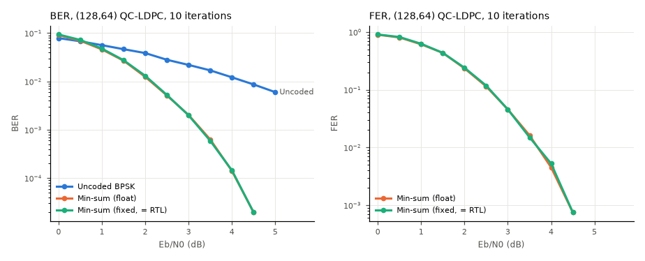

# fpga-jesd204b-ldpc

SystemVerilog for a JESD204B-style link layer and a QC-LDPC encoder/decoder,
Python reference models that check the RTL bit for bit, and a scripted
Vivado non-project build flow that expands a parameter sweep into 72 build
configurations. A first-order power/thermal model estimates junction
temperature for each configuration.

Everything reported here comes from simulation (Verilator 5.020) or from
Python models. **Vivado was not available, so none of the builds were run**.
There are no utilisation, timing or power results from a real tool, and the
thermal numbers are modeled from assumed coefficients.

## Contents

| Area | Files | What it does |
|---|---|---|
| 8b/10b | `rtl/jesd/jesd_pkg.sv`, `enc_8b10b.sv`, `dec_8b10b.sv` | table-driven encoder with running disparity; decoder that classifies each symbol as valid / disparity error / code error by re-encoding |
| JESD204B TX | `rtl/jesd/jesd_tx.sv` | CGS (/K/), ILAS (4 multiframes, /R/ /Q/ /A/, 14-octet config with FCHK) at the LMFC boundary after SYNC~, scrambler 1 + x^14 + x^15, /F/ and /A/ character replacement (scrambled and unscrambled rules), L lanes |
| JESD204B RX | `rtl/jesd/comma_align.sv`, `jesd_rx.sv` | comma-based word alignment of an arbitrary bit offset, code group sync FSM, SYNC~ generation, per-lane elastic buffers started at /R/, simultaneous release for lane deskew, ILAS structure/config check, descrambler, alignment-character monitoring |
| LDPC | `rtl/ldpc/ldpc_encoder.sv`, `ldpc_decoder.sv`, `ldpc_dec_array.sv` | (128,64) rate-1/2 QC-LDPC (4x8 base matrix, Z = 16, girth >= 6); one-cycle encoder; layered offset min-sum decoder (6-bit channel LLRs, 8-bit posteriors, 6-bit messages, early termination); array of `NUM_DEC` cores with dispatch and tagged out-of-order results |
| Top | `rtl/top/fpga_top.sv` | link layer + codec side by side, parameterised for the sweep |
| Models | `jesdldpc/enc8b10b.py`, `jesd.py`, `ldpc.py`, `thermal.py` | reference models: 8b/10b tables, link-layer TX/RX, code construction, float and bit-exact fixed-point decoders, AWGN channel, thermal model |
| Build flow | `scripts/gen_configs.py`, `vivado/build.tcl`, `vivado/run_sweep.tcl`, `vivado/run_sweep.sh` | sweep generator -> per-config TCL; non-project synth/place/route with per-config clock constraints and summary CSV (not run) |

Simplifications compared with a full JESD204B core: one octet per lane per
clock, no SYSREF/subclass-1 deterministic latency (the LMFC counter is free
running), only K28.y control characters, and a simplified CGS state
machine (4 good /K/ to sync, 4 consecutive bad characters to drop). The
serial transceivers are not modeled. The testbench channel serialises the
10-bit symbols and applies a per-lane bit delay instead.

## How to run

```bash
# model unit tests (host Python with numpy, pytest)
python -m pytest -q tests

# all RTL testbenches + bit-exact checks (Verilator in the tool container
# through scripts/docker_run.sh); writes results/sim_results.{md,json}
python scripts/run_sims.py --seeds 5 --frames 100

# BER/FER Monte-Carlo (float vs fixed-point vs uncoded); results/ber_fer.*
python scripts/ber_sim.py --max-frames 4000 --min-errors 100

# build sweep: 72 configs, and a Verilator elaboration of each RTL parameter set
python scripts/gen_configs.py --lint
# modeled power / junction temperature for every config
python scripts/thermal_report.py

# on a machine with Vivado (not run here)
vivado -mode batch -source vivado/build.tcl -tclargs build/configs/L4_D2_C246_S1.tcl
vivado/run_sweep.sh 4
```

`scripts/gen_code.py --search` reproduces the choice of LDPC shift values,
and `scripts/gen_code.py` regenerates `rtl/ldpc/ldpc_code.svh` from the
model so the RTL and Python share one code definition.

## Results

### 8b/10b (`results/sim_results.md`)

- Encoder: all 528 table entries (256 data + 8 K28.y, both disparities)
  match the Python model.
- Decoder: all 2 048 cases (1 024 codes x 2 starting disparities) match
  the model's value, K flag, code-error, disparity-error and output RD.
- Random encoder-to-decoder loopback: 100 000 symbols, 0 errors, maximum run
  length 5.

### JESD204B link loopback (5 seeds per configuration, random lane delays of 0-129 bits)

| Lanes | Scrambling | Seeds passed | Link-up (cycles) | Data words compared | Mismatches | Single-bit error detected, link kept | Sync loss -> re-link | TX lane 0 vs model |
|---:|---|---:|---|---:|---:|---|---|---|
| 1 | on | 5/5 | 170-181 | 20 000 | 0 | 5/5 | 5/5 | 2 176/2 176 octets and symbols exact |
| 2 | on | 5/5 | 176-181 | 20 000 | 0 | 5/5 | 5/5 | exact |
| 4 | on | 5/5 | 176-181 | 20 000 | 0 | 5/5 | 5/5 | exact |
| 8 | on | 5/5 | 176-181 | 20 000 | 0 | 5/5 | 5/5 | exact |
| 2 | off | 5/5 | 176-181 | 20 000 | 0 | 5/5 | 5/5 | exact |

In every run each lane's comma-alignment offset equalled its injected
delay modulo 10, ILAS and configuration checks passed, and no misplaced
/A/ or /F/ characters were seen.

The sync-loss test found a real bug. In the first version, the RX lane
buffers started on the first non-/K/ character. After a re-sync, a lane
with a long channel delay still delivered stale data characters from the
previous link. Its buffer started 34 octets early and overflowed, which
caused the 4- and 8-lane failures. The buffers now start only on the /R/
that opens the ILAS.

### LDPC RTL vs bit-exact model (100 frames per point)

- Encoder: 1 000 random messages, 0 codeword mismatches.
- Decoder: 1 200 decodes (4 Eb/N0 points x 3 core counts), **0 mismatches** in
  hard decisions, iteration counts and converged flags against
  `ldpc.decode_fixed`.

| Eb/N0 (dB) | Frames converged | RTL FER | Avg iterations | Cycles/frame, 1 core | 2 cores | 4 cores |
|---:|---:|---:|---:|---:|---:|---:|
| 1.0 | 33/100 | 0.69 | 7.93 | 295.4 | 149.0 | 74.9 |
| 2.0 | 60/100 | 0.40 | 6.09 | 227.3 | 115.0 | 58.2 |
| 3.0 | 94/100 | 0.06 | 2.78 | 104.9 | 52.5 | 26.4 |
| 4.0 | 100/100 | 0.00 | 1.58 | 60.5 | 30.2 | 15.7 |

Cycles/frame are simulated clock cycles from reset to the last result,
divided by the frame count. Each iteration takes 2 x 18 block operations
plus a syndrome check. Throughput scales almost linearly with the number
of decoder cores (3.85x to 3.97x at 4 cores), at the cost of 4x the decoder
logic. No clock frequency has been verified, because synthesis was not run.

### BER / FER (Monte-Carlo, `results/ber_fer.md`)



| Eb/N0 (dB) | Uncoded BER | Float min-sum FER | Fixed-point FER | Fixed-point BER | Frames |
|---:|---:|---:|---:|---:|---:|
| 1.0 | 5.6e-2 | 0.611 | 0.624 | 4.8e-2 | 1 000 |
| 2.0 | 3.9e-2 | 0.234 | 0.240 | 1.3e-2 | 1 000 |
| 3.0 | 2.2e-2 | 4.6e-2 | 4.6e-2 | 2.0e-3 | 2 500 |
| 4.0 | 1.2e-2 | 4.5e-3 | 5.3e-3 | 1.5e-4 | 4 000 |
| 4.5 | 8.7e-3 | 7.5e-4 | 7.5e-4 | 2.0e-5 | 4 000 |

The 6/8-bit fixed-point decoder stays within the Monte-Carlo noise of the
floating-point decoder at every point. This is a short (n = 128) code, so it
is weak. At 0-0.5 dB its BER is slightly worse than uncoded BPSK, and it
needs about 4.5 dB to reach FER around 1e-3.

### Build sweep and thermal model

- `scripts/gen_configs.py` generated **72 configurations**: lanes {1, 2, 4, 8}
  x decoder cores {1, 2, 4} x character clock {122.88, 153.6, 245.76} MHz x
  scrambling {off, on}. Each has its own TCL file and clock constraint.
- The 24 distinct RTL parameter sets elaborate cleanly with Verilator
  `--lint-only` (24/24). The Vivado builds themselves were not run.
- Thermal estimate (**modeled**, `results/thermal_model.md`):
  `Tj = Ta + P * theta_JA`, where static power rises with temperature and is
  solved iteratively. Modeled total power ranges from 0.77 W (1 lane, 1
  core, 122.88 MHz) to 2.28 W (8 lanes, 4 cores, 245.76 MHz, 50 degC
  ambient). Worst case Tj is 71.7 degC at 50 degC ambient with no heatsink
  (theta_JA 9.5 degC/W assumed) and 55.6 degC with a heatsink and 200 LFM.
  No configuration exceeds the 100 degC limit under these assumptions. The
  coefficients are placeholders to be replaced by vendor power-estimator
  or `report_power` data.

## Layout

```
rtl/jesd/   8b/10b, scrambler package, comma aligner, TX and RX link layer
rtl/ldpc/   encoder, decoder, decoder array, generated code tables (svh)
rtl/top/    fpga_top for synthesis
tb/         tb_8b10b, tb_jesd_link, tb_ldpc_enc, tb_ldpc_dec
jesdldpc/   Python reference models
scripts/    run_sims, ber_sim, gen_code, gen_configs, thermal_report, docker_run.sh
vivado/     build.tcl, run_sweep.tcl, run_sweep.sh   (not run)
tests/      pytest for the models
results/    generated reports and the BER/FER plot
```

## Limitations

- Simulation only. No synthesis, timing closure, hardware or transceiver
  testing was done.
- The link layer is a JESD204B subset: there is no SYSREF / deterministic
  latency, no transport layer (sample mapping) and no multi-octet datapath.
  The decoder accepts all 128 LLRs in one wide transfer, which suits
  simulation more than a real I/O budget.
- Icarus Verilog 12 was tried for the 8b/10b testbench. It compiled the
  design but was impractically slow on the combinational decoder, so all
  reported runs use Verilator.
- The power and thermal figures come from a model with assumed coefficients.
